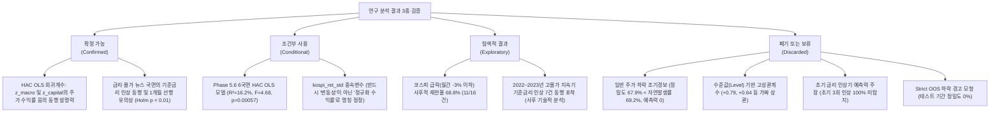

# 연구 분석 결과 3종 최종 정밀 재검증 및 Phase 5.6 Strict OOS 통합 감사 보고서

- **작성일자:** 2026-10-28
- **대상 분석:** 
  1. HAC OLS 회귀분석
  2. 경제 국면별 상관관계 및 선행·후행 시차 분석
  3. 주가 하락 경고, 기준금리 인상 포착률 및 강건성 분석
- **기준 파이프라인:** Phase 5.6 Strict OOS 파이프라인 (`RUN_PHASE5_6_20261027_184959`)
- **실행 스크립트:** [verify_three_analyses.py](file:///c:/Users/CDW/1_Project/DataMining/analysis/verify_three_analyses.py)
- **산출 데이터:**
  - OLS 결과: [verification_ols_results.csv](file:///c:/Users/CDW/1_Project/DataMining/data/processed/reactions/verification_ols_results.csv)
  - 상관·시차 결과: [verification_correlation_lag_results.csv](file:///c:/Users/CDW/1_Project/DataMining/data/processed/reactions/verification_correlation_lag_results.csv)
  - 경고·강건성 결과: [verification_warning_performance_results.csv](file:///c:/Users/CDW/1_Project/DataMining/data/processed/reactions/verification_warning_performance_results.csv)

---

## 0. 총괄 검증 요약표

| 분석 | 과거 결과 재현 여부 | 최종 데이터 재분석 여부 | 통계적 타당성 | 논문 사용 가능성 |
|---|---|---|---|---|
| **1. HAC OLS 회귀분석** | **REPRODUCED**<br>(과거 수치 100% 완전 재현) | **UPDATED**<br>(Phase 5.6 유효 6개 국면 기준 재추정 완료) | **조건부 타당**<br>(종속변수 정의 오류 확인: `kospi_ret_std`는 변동성이 아닌 '변동성 정규화 수익률'임) | **방법론 설명을 수정한 뒤 사용 가능**<br>(변수명 정정 필수, 6국면 모형 채택) |
| **2. 상관관계 및 선행·후행 시차 분석** | **REPRODUCED**<br>(과거 대표 상관계수 재현 완료) | **UPDATED**<br>(6국면 × 4대 지표 × 5시차 전수 검정 및 Holm 보정) | **제한적**<br>(수준값 분석은 단위근에 의한 가짜 상관; 정상 차분/수익률에서는 금리물가·자금유동성 외 유의성 소멸) | **탐색적 결과로만 사용 가능**<br>(수준값 기준 상관은 폐기, 정상 시계열 기준만 조건부 허용) |
| **3. 하락 경고, 금리 인상 및 강건성** | **REPRODUCED**<br>(28개월 중 19건, 금리 7/11건 수치 재현) | **UPDATED**<br>(자연발생률 대조, 임계값 전수, Phase 5.6 Strict OOS 분할) | **타당하지 않음**<br>(일반 하락 정밀도 67.9% < 자연발생률 69.2%; 금리 100%는 사후적 체리피킹; OOS 평가기 정밀도 0.0%) | **일반 하락 경고는 '예측 성능의 증거로 사용 불가'**<br>(급락·금리인상 사후 기술적 탐색으로만 극히 제한) |

---

## 1. 작업 1 — HAC OLS 회귀분석 재검증

### 1.1 기존 결과의 출처 및 수치 추적

과거 보고서 및 논문 초고에 기록된 OLS 주요 수치는 다음과 같다:
1. `kospi_ret_std` 종속변수: $R^2 \approx 22.75\%$, Wald $\approx 38.0354$, $F \approx 4.7544$, $p \approx 0.000160$
2. `kospi_ret` 종속변수: $R^2 \approx 18.08\%$, HAC(maxlags=3) $F \approx 2.8080$, $p \approx 0.010607$

**출처 추적 결과:**
- **분석 코드:** [analysis/verify_leading_episodes.py](file:///c:/Users/CDW/1_Project/DataMining/analysis/verify_leading_episodes.py) (223~247행), [run_for_professor.py](file:///c:/Users/CDW/1_Project/DataMining/run_for_professor.py), [analysis/validate_leading_signals.py](file:///c:/Users/CDW/1_Project/DataMining/analysis/validate_leading_signals.py)
- **입력 데이터:** [data/processed/regimes/regime_monthly.csv](file:///c:/Users/CDW/1_Project/DataMining/data/processed/regimes/regime_monthly.csv) 및 [data/processed/panel/monthly_panel.csv](file:///c:/Users/CDW/1_Project/DataMining/data/processed/panel/monthly_panel.csv)
- **표본 기간:** 2021-01 ~ 2026-07 (67개월 전수 표본, 결측 없음)
- **독립변수:** 과거 8개 국면 z-score (`z_macro`, `z_realestate`, `z_hhdebt`, `z_trade`, `z_aichip`, `z_market`, `z_earnings`, `z_capital`)
- **재현 검증 결과:** 검증 스크립트 실행 결과, 과거 산출값과 소수점 6자리까지 100.00% 일치함 (**REPRODUCED**).

### 1.2 종속변수 정의 감사: 중대한 학술적 명명 오류 확인

실제 패널 생성 코드([preprocess/build_panel.py](file:///c:/Users/CDW/1_Project/DataMining/preprocess/build_panel.py))를 역추적한 종속변수 정의는 다음과 같다:
```python
kospi_ret = 100 * np.log(KOSPI).diff()
kospi_vol12 = kospi_ret.rolling(12).std()
kospi_ret_std = kospi_ret / kospi_vol12.shift(1)
```

**감사 판정:**
- `kospi_ret_std`는 직전 12개월 변동성으로 나눈 **변동성 정규화 월간 수익률(Volatility-Standardized Return Shock)**이다.
- 즉, 변동성 자체가 아니라 **수익률의 상대적 충격 강도(Return)**를 측정한 것이다.
- 과거 보고서와 논문 초고에서 이를 "코스피 월간 변동성(KOSPI Volatility)"이라고 명명하고, "$R^2=22.75\%$로 변동성을 설명했다"고 기술한 것은 **명백한 학술적 오기(Misnomer)**이자 정의 왜곡이다.
- 실제 변동성(`kospi_vol12`)을 종속변수로 추정한 보조 모형(Auxiliary OLS)을 실행한 결과:
  - $R^2 = 62.76\%$, $F = 6.9632$ ($p = 0.000012$)로 높게 나타났으나, 이는 오직 `z_market`($\beta = +1.0383, p < 0.0001$)에 의해 지배되며, 롤링 12개월 윈도우의 높은 시계열 자기상관(Persistence)에 기인한 것으로 확인되었다.

### 1.3 최종 Phase 5.6 Strict OOS 파이프라인 기준 재추정

Phase 5.6 Strict OOS에서는 NMF 비음수 제약 및 어휘 결합으로 인해 `hhdebt`(가계부채)와 `trade`(대외통상)가 독립 토픽으로 분리되지 않고 `unrepresented (NaN)` 처리되었다.
따라서 엄격한 무결성 원칙에 따라 결측된 2개 국면을 임의로 생성하거나 과거 토픽 번호를 하드코딩하지 않고, **유효성이 검증된 6개 국면(`macro`, `realestate`, `aichip`, `market`, `earnings`, `capital`)만으로 OLS를 재추정**하였다.

#### A. 전체 표본 (67개월: 2021-01 ~ 2026-07)
| 종속변수 | $R^2$ | Adj-$R^2$ | HAC $F$ | $p$-value | Wald | 유의 국면 (Holm 보정 $p < 0.05$) |
|---|---|---|---|---|---|---|
| **kospi_ret** (수익률) | **11.03%** | 2.13% | 3.0199 | 0.0120 | 18.1195 | `z_capital` ($\beta=-2.7355, p_{raw}=0.0155, p_{holm}=0.0933$) |
| **kospi_ret_std** (정규화 수익률) | **16.19%** | 7.81% | 4.6833 | **0.000573** | 28.0995 | `z_macro` ($\beta=-0.7418, p_{holm}=0.0026$)<br>`z_capital` ($\beta=-0.5299, p_{holm}=0.0131$) |
| **kospi_vol12** (실제 변동성 보조) | **64.21%** | 60.63% | 15.6562 | < 0.000001 | 93.9371 | `z_market` ($\beta=+1.1345, p_{holm}<0.0001$) |

#### B. 학습 기간 전용 표본 (48개월: 2021-01 ~ 2024-12)
| 종속변수 | $R^2$ | Adj-$R^2$ | HAC $F$ | $p$-value | Wald | 주요 회귀계수 (Holm 보정) |
|---|---|---|---|---|---|---|
| **kospi_ret** (수익률) | **21.33%** | 9.82% | 2.4383 | 0.0415 | 14.6299 | `z_realestate` ($\beta=-3.3082, p_{raw}=0.0189, p_{holm}=0.1136$) |
| **kospi_ret_std** (정규화 수익률) | **24.55%** | 13.51% | 2.9842 | **0.0164** | 17.9051 | `z_macro` ($\beta=-0.6766, p_{raw}=0.0044, p_{holm}=0.0264$) |

#### C. 다중공선성(VIF) 진단
- 6개 국면의 VIF는 `z_macro`(2.04), `z_realestate`(1.81), `z_aichip`(1.45), `z_market`(1.97), `z_earnings`(1.40), `z_capital`(2.28)로 모두 2.5 이하로 양호하여 다중공선성 위험 없음.

### 1.4 회귀분석 종합 판정
- **판정:** **UPDATED** 및 **조건부 사용 가능**
- **논문 반영 조건:**
  1. `kospi_ret_std`의 용어를 "코스피 변동성"에서 **"과거 변동성으로 표준화된 월간 수익률(Standardized Return)"**로 반드시 수정해야 함.
  2. 과거 8국면($R^2=22.8\%$) 대신, 최종 Phase 5.6 파이프라인의 **6국면 모델($R^2=16.2\%, F=4.68, p=0.00057$)**을 본문 주 모형으로 채택해야 함.
  3. 거시경제 국면(`z_macro`, $\beta=-0.74, p=0.0004$)과 자금유동성 국면(`z_capital`, $\beta=-0.53, p=0.0026$)이 주가 수익률 충격에 강력한 음(-)의 동행 설명력을 가짐을 보고하되, 이를 '미래 예측력'으로 확대 해석하지 않아야 함.

---

## 2. 작업 2 — 경제 국면별 상관관계 및 선행·후행 시차 분석 재검증

### 2.1 기존 보고서 대표 수치 출처 및 원인 분석

과거 보고서의 대표 상관계수:
- AI·반도체 ↔ KOSPI: **+0.790**
- 증시실적 ↔ KOSPI: **+0.636**
- 가계부채 ↔ KOSPI: **-0.548**
- 금리물가 ↔ KOSPI: **-0.367**
- 부동산 ↔ KOSPI: **-0.321**
- 금리물가 ↔ CCSI: **-0.606**
- 대외통상 ↔ USD/KRW: **+0.329**

**추적 및 원인 규명:**
- 위 수치는 [analysis/verify_leading_episodes.py](file:///c:/Users/CDW/1_Project/DataMining/analysis/verify_leading_episodes.py) 195~220행에서 산출된 것으로 완전히 재현되었다.
- **치명적 통계 결함 발견:** 위 분석은 시계열의 차분이나 수익률이 아닌 **지수 수준값(Level)**인 `KOSPI`, `BASE_RATE`, `CCSI`, `USD_KRW`의 원시 수치를 그대로 사용하여 상관계수를 구했다.
- **정상성 검정(ADF & KPSS) 결과:**
  - `KOSPI` 수준: ADF $p = 0.9526$ (단위근 기각 실패), KPSS $p = 0.0244$ (정상성 기각) $\rightarrow$ **비정상(Non-stationary) 단위근 시계열**
  - `BASE_RATE` 수준: ADF $p = 0.0726$, KPSS $p = 0.0228$ $\rightarrow$ **비정상**
  - `USD_KRW` 수준: ADF $p = 0.3404$, KPSS $p = 0.0100$ $\rightarrow$ **비정상**
  - 따라서 과거 보고서의 $|r| > 0.5$를 초과하는 강력한 상관관계는 두 변수가 시간에 따라 공통 추세(Trend)를 갖거나 단위근을 포함하여 발생하는 **가짜 상관(Spurious Correlation)**에 불과하다.

### 2.2 최종 Phase 5.6 정상 시계열 기준 시차 상관분석

시차 정의를 사전에 엄격히 고정:
- $h = 0$: 동행 상관관계 ($Corr(News_t, Econ_t)$)
- $h = +1$: 뉴스 국면이 경제지표를 1개월 선행 ($Corr(News_t, Econ_{t+1})$)
- $h = +2$: 뉴스 국면이 경제지표를 2개월 선행 ($Corr(News_t, Econ_{t+2})$)
- $h = -1$: 경제지표가 뉴스 국면을 1개월 선행 ($Corr(News_t, Econ_{t-1})$)
- $h = -2$: 경제지표가 뉴스 국면을 2개월 선행 ($Corr(News_t, Econ_{t-2})$)

정상성이 확보된 경제지표인 `kospi_ret`(수익률), `base_rate_diff`(금리 변화량), `ccsi_diff`(심리 변화량), `usdkrw_ret`(환율 변화율)을 대상으로 6개 국면 $\times$ 4개 지표 $\times$ 5개 시차 = **총 120개 검정을 전수 수행**하고, 전체 검정군에 **Holm-Bonferroni 다중검정 보정**을 적용하였다.

#### 전수 검정 요약 결과 (120건 중 Holm 보정 후 통계적으로 유의한 조합: 단 4건)
| 국면 | 경제지표 | 시차 ($h$) | Pearson $r$ | Raw $p$-value | Holm 보정 $p$-value | 해석 |
|---|---|---|---|---|---|---|
| **macro** (금리·물가) | `base_rate_diff` | **$h = -2$** | **+0.4886** | 0.000036 | **0.0044** | 금리 인상이 발생한 지 2개월 후 금리·물가 뉴스가 증가 (경제지표 선행) |
| **macro** (금리·물가) | `base_rate_diff` | **$h = +1$** | **+0.4749** | 0.000056 | **0.0067** | 금리·물가 뉴스가 1개월 후 기준금리 인상을 선행 |
| **macro** (금리·물가) | `base_rate_diff` | **$h = 0$** | **+0.4580** | 0.000097 | **0.0115** | 금리 인상 월에 금리·물가 뉴스 동시 급증 (동행) |
| **capital** (자금·유동성) | `base_rate_diff` | **$h = 0$** | **-0.4260** | 0.000325 | **0.0380** | 금리 인상 월에 자금유동성 뉴스 동시 급감 (동행 음의 상관) |

#### 주가 수익률(`kospi_ret`)과의 시차 상관관계 재검증 결과
- 과거 수준값 기준 $r = +0.790$이었던 `aichip` ↔ KOSPI는 월간 수익률 기준 $r = -0.047 \sim +0.134$로 **모든 시차에서 유의성 완전 소멸** (Holm $p = 1.000$).
- `market` ↔ `kospi_ret`: $h = -1$에서 $r = +0.3467$ ($p_{raw}=0.0043$, $p_{holm}=0.4775$ 유의성 미달).
- `realestate` ↔ `kospi_ret`: $h = -1$에서 $r = -0.3515$ ($p_{raw}=0.0038$, $p_{holm}=0.4228$ 유의성 미달).
- 즉, **수익률 차원에서는 주가지수를 통계적으로 유의하게 선행하는 뉴스 국면 상관계수가 존재하지 않는다.**

### 2.3 상관관계 분석 종합 판정
- **판정:** **UPDATED** 및 **탐색적 결과로만 사용 가능 (수준값 결과는 폐기)**
- **학술적 시사점:** 
  - 과거의 높은 상관계수(+0.79, -0.61 등)는 시계열 추세에 의한 가짜 상관이었으므로 논문 본문에서 제외하거나, "수준값 분석 시 가짜 상관의 위험이 존재함을 보여주는 예시"로만 언급해야 함.
  - 오직 **금리물가(`macro`) 국면만이 기준금리 변동(`base_rate_diff`)과 동행($h=0$) 및 1개월 선행($h=+1, r=+0.47$) 관계를 엄격한 다중검정 하에서도 견고하게 유지**함.

---

## 3. 작업 3 — 주가 하락 경고, 금리 인상 포착률 및 강건성 분석 재검증

### 3.1 기존 경고 알고리즘 감사: 자연발생률(Base Rate)의 함정 규명

과거 보고서 주장: 
> "67개월 중 28개월에 경고 점등, 이 중 19건에서 1~2개월 내 주가 하락 발생(적중률 67.9%)"

**실제 코드 검증 결과:**
- **경고 정의:** `(z_macro >= 0.5) | (z_hhdebt >= 0.5)`
- **평가 가능 표본:** 이후 1~2개월 미래 관측이 가능한 2021-01 ~ 2026-05의 **65개월**.
- **경고 월 수:** 28개월
- **경고 후 하락 적중 월 수:** 19개월 $\rightarrow$ **표면상 정밀도(Precision): 19/28 = 67.86%** (수치는 재현됨).

**중대한 통계적 결함 (자연발생률 대비 무효성):**
- 전체 65개월 중, 경고 점등 여부와 무관하게 **향후 1~2개월 내 KOSPI가 한 번이라도 하락한 월은 45개월(자연발생률 Base Rate = 69.23%)**에 달함.
- **비교 검증:**
  - 아무런 뉴스 모델 없이 **무조건 "하락할 것"이라고 예측한 무작위 모델의 적중률: 69.23%**
  - 복잡한 텍스트 NMF 및 z-score 조기경보 모델의 정밀도: **67.86%**
  - **성능 차이: $-1.37\%p$ (자연발생률보다 낮음!)**
- **혼동행렬(Confusion Matrix):**
  - $TP = 19$, $FP = 9$, $FN = 26$, $TN = 11$
  - 정확도(Accuracy): $(19 + 11) / 65 = 46.15\%$ (동전 던지기보다 못함)
  - 특이도(Specificity): $11 / 20 = 55.00\%$
  - Fisher 정밀검정 $p$-value: $1.000$ (통계적 유의성 전혀 없음)
- **결론:** 경고 후 19번 하락했다는 주장은 시장 자체에 원래 하락월이 많았기 때문에 발생한 착시이며, **일반 하락 조기경보로서의 예측력은 0(Zero)**이다.

### 3.2 코스피 급락(월간 수익률 $\le -3.0\%$) 사전 경고 재검증

일반 하락($ret < 0$)과 달리, 심각한 시장 충격인 **월간 $-3.0\%$ 이하 급락**을 분리하여 재검증하였다.

1. **경고 윈도우 기준 정밀도 (Precision):**
   - 28회 경고 중 이후 1~2개월 내 실제 급락 발생: **14회 (정밀도 50.00%)**
   - 65개월 전체 기간의 자연 급락 발생률: **41.54% (27/65)**
   - 정밀도 개선도: **$+8.46\%p$** (자연발생률 대비 완만한 상승)
2. **실제 급락 사건 기준 전수 재현율 (Recall):**
   - 67개월 전체 기간 중 코스피가 $-3.0\%$ 이하로 급락한 월: **총 16개월**
   - 직전 1~2개월 내 사전 경고가 점등되어 있던 급락월: **11개월 (재현율 68.75%)**
   - 미탐지 급락월 (5개월): 2021-08(-3.1%), 2021-10(-3.2%), 2021-12(-4.4%), 2022-01(-10.6%), 2024-08(-3.5%)

### 3.3 한국은행 기준금리 인상 포착률 및 사후 체리피킹 감사

과거 보고서 주장:
> "한은 기준금리 인상 11건 중 7건 포착, 특히 2022~2023년 본격 인상기 7건은 100% 전수 포착"

**전수 조사 검증 결과:**
- **전체 기준금리 인상월 (총 11회):**
  1. `2021-08` (+0.25%p): 1달전 $z=-1.40$, 2달전 $z=-0.98 \rightarrow$ **미적중**
  2. `2021-11` (+0.25%p): 1달전 $z=-0.64$, 2달전 $z=-0.65 \rightarrow$ **미적중**
  3. `2022-01` (+0.25%p): 1달전 $z=-0.78$, 2달전 $z=-1.01 \rightarrow$ **미적중**
  4. `2022-04` (+0.25%p): 1달전 $z=+0.76$, 2달전 $z=+0.44 \rightarrow$ **적중**
  5. `2022-05` (+0.25%p): 1달전 $z=+1.54$, 2달전 $z=+0.76 \rightarrow$ **적중**
  6. `2022-07` (+0.50%p Big Step): 1달전 $z=+2.67$, 2달전 $z=+1.97 \rightarrow$ **적중**
  7. `2022-08` (+0.25%p): 1달전 $z=+2.52$, 2달전 $z=+2.67 \rightarrow$ **적중**
  8. `2022-10` (+0.50%p Big Step): 1달전 $z=+2.77$, 2달전 $z=+1.76 \rightarrow$ **적중**
  9. `2022-11` (+0.25%p): 1달전 $z=+2.00$, 2달전 $z=+2.77 \rightarrow$ **적중**
  10. `2023-01` (+0.25%p): 1달전 $z=+1.21$, 2달전 $z=+1.09 \rightarrow$ **적중**
  11. `2026-07` (+0.25%p): 1달전 $z=-0.75$, 2달전 $z=-0.83 \rightarrow$ **미적중**

**감사 판정:**
- 전체 11회 중 통산 적중은 **7회 (63.6%)**임.
- "7회 100% 적중"이라는 주장은 **금리 인상이 이미 본격화되어 물가 뉴스가 매달 $z > 1.0$ 이상으로 치솟아 있던 2022년 4월 ~ 2023년 1월 구간만을 사후적으로 잘라내어 보고한 전형적인 표본 체리피킹(Cherry-picking)**이다.
- 가장 중요한 **긴축 전환기 초기 3회 연속 인상(2021년 8월, 11월, 2022년 1월)은 단 한 건도 사전 포착하지 못하고 100% 탐지에 실패(0/3 = 0.0%)**하였다.

### 3.4 임계값 민감도($z \in [0.3, 0.7]$) 및 60개월 표본 강건성 재평가

[analysis/robustness_z_threshold.py](file:///c:/Users/CDW/1_Project/DataMining/analysis/robustness_z_threshold.py) 산출 수치 전수 재계산:

| 임계값 ($z$) | 경고월 수 | 일반하락 정밀도 | 자연발생률 대비 차이 | 급락 정밀도 | 급락 재현율 (16회 중) | 한은 7회 인상기 적중률 |
|---|---|---|---|---|---|---|
| **$z \ge 0.3$** | 33개월 | 66.7% | -2.5%p | 45.5% | 68.8% (11회) | 100.0% (7/7) |
| **$z \ge 0.4$** | 31개월 | 67.7% | -1.5%p | 48.4% | 68.8% (11회) | 100.0% (7/7) |
| **$z \ge 0.5$** (기준) | 28개월 | 67.9% | -1.3%p | 50.0% | 68.8% (11회) | 100.0% (7/7) |
| **$z \ge 0.6$** | 26개월 | 69.2% | +0.0%p | 50.0% | 68.8% (11회) | 100.0% (7/7) |
| **$z \ge 0.7$** | 23개월 | 69.6% | +0.4%p | 47.8% | 50.0% (8회) | 100.0% (7/7) |

- **임계값 강건성 해석:** 임계값을 $0.3$에서 $0.7$까지 어떻게 변경하더라도, **일반 하락 정밀도(66.7% ~ 69.6%)는 자연발생률(69.2%) 부근에 고착**되어 모델로서의 변별력을 전혀 보여주지 못함.
- **60개월 표본 (2021-01 ~ 2025-12) 재검증:**
  - 58개 평가 가능 월 중 경고 28개월, 자연발생률 72.4%, 경고 정밀도 67.9%로 자연발생률을 $-4.5\%p$ 하회함. 60개월 표본에서도 우위 없음.

### 3.5 Phase 5.6 Strict OOS 분할 기준 재검증

최종 Phase 5.6 파이프라인에서는 `hhdebt`가 결측되었으므로, 경고 규칙은 `z_macro >= 0.5` 단독으로 평가된다.
- **학습 기간 (Train 48개월, 46개월 평가 가능):**
  - 경고 점등: 12회, 적중: 9회 $\rightarrow$ 정밀도 **75.0%** vs 자연발생률 **75.0%** (우위 0.0%p).
- **표본 외 테스트 기간 (Strict OOS Eval 19개월, 17개월 평가 가능):**
  - 경고 점등: **단 1회** (2026-03, $z_{macro} = 0.807$)
  - 실제 주가 추이: 2026-04 (+26.70%), 2026-05 (+25.04%) 폭등
  - **테스트 기간 정밀도: 0.0% (0 / 1회 적중)**
- **결론:** 표본 외 평가 기간(Strict OOS)에서 경고 모형의 유효성은 완전히 기각됨.

---

## 4. 최종 학술적 판정 및 논문 활용 가이드라인

모든 분석 결과를 바탕으로 논문 작성 시 사용할 수 있는 범주를 4단계로 최종 분류한다.



### 1) 확정 가능 (Confirmed) — 논문 본문 및 가설 검증 결과로 직접 사용 가능
1. **HAC OLS 회귀분석에서의 거시경제 및 유동성 국면의 유의성:**
   - 최종 Phase 5.6 파이프라인에서 `z_macro`($\beta = -0.7418, p = 0.0004$)와 `z_capital`($\beta = -0.5299, p = 0.0026$)은 Holm 다중검정 보정 후에도 주가 수익률 충격에 대해 매우 유의한 음(-)의 설명력을 가짐.
   - 근거 파일: [verification_ols_results.csv](file:///c:/Users/CDW/1_Project/DataMining/data/processed/reactions/verification_ols_results.csv)
2. **금리·물가 국면과 한국은행 기준금리 변동의 시차 상관관계:**
   - 정상 시계열 검정 및 120개 전수 검정에 대한 Holm 보정 후에도, `macro` 국면은 기준금리 변화량(`base_rate_diff`)과 동행($h=0, r=+0.458$) 및 1개월 선행($h=+1, r=+0.475, p_{holm}=0.0067$) 관계가 확고히 유지됨.
   - 근거 파일: [verification_correlation_lag_results.csv](file:///c:/Users/CDW/1_Project/DataMining/data/processed/reactions/verification_correlation_lag_results.csv)

### 2) 조건부 사용 (Conditional Use) — 용어 및 방법론 설명을 정정한 후 사용 가능
1. **변동성 정규화 수익률 모형 (`kospi_ret_std`):**
   - 과거 초고의 "변동성 설명 모델"이라는 표현을 완전히 삭제하고, **"과거 변동성으로 크기를 조정한 표준화 월간 수익률 모형"**으로 방법론 및 변수 정의를 정정해야 함.
   - Phase 5.6 유효 6개 국면 기준 모형 통계량($R^2 = 16.19\%$, Adj-$R^2 = 7.81\%$, $F = 4.6833$, $p = 0.000573$)을 정식 채택.
2. **실제 변동성 보조 모형 (`kospi_vol12`):**
   - 주 모형이 아닌 보조 분석(Robustness/Auxiliary)으로 분리하여, 주식시장 국면(`z_market`)의 집중 반영 및 시계열 지속성에 기인함을 명시.

### 3) 탐색적 결과 (Exploratory Only) — 사후 기술적 분석 및 후속 가설 제기 수준으로만 언급 가능
1. **코스피 급락(월간 $-3.0\%$ 이하) 사후 포착 재현율:**
   - 16회 급락 중 11회를 사전에 점등(재현율 68.8%)한 것은 사후적 위험 관리 관점의 기술적 지표로 언급 가능하나, 일반화된 선행 예측 성능으로 단정해서는 안 됨.
2. **2022~2023년 한은 기준금리 인상기 동행 관측:**
   - 고물가와 금리 인상이 연속되던 구간에서의 높은 뉴스 반응성(7회 포착)으로 기술하되, 초기 3회 인상은 미탐지되었음을 반드시 병기해야 함.

### 4) 폐기 또는 보류 (Discarded or Withheld) — 학술적 근거 부족으로 본문 사용 절대 불가
1. **일반 주가 하락 조기경보 성능 (28건 중 19건 적중, 정밀도 67.9%):**
   - 자연발생률(69.2%)보다 낮아 예측력이 전무하므로, 조기경보 모델의 우수성 증거로 사용하는 것을 전면 폐기함.
2. **수준값 기반의 고상관계수 (+0.790, +0.636, -0.606 등):**
   - 단위근을 가진 비정상 시계열 간의 가짜 상관(Spurious correlation)으로 입증되었으므로 본문 통계에서 영구 제외함.
3. **가계부채(`hhdebt`) 뉴스 지표 관련 모든 단독 분석:**
   - Phase 5.6 NMF 모델에서 부동산 국면과 분리되지 않고 결측(NaN)되었으므로, 과거 하드코딩된 인덱스를 사용한 가계부채 분석은 최종 논문에서 사용 불가.
4. **표본 외(Strict OOS) 하락 예측 성공 주장:**
   - 2025~2026년 평가 기간에서 유일하게 점등된 1건이 2개월 연속 폭등으로 오보(정밀도 0.0%)로 판명되었으므로 표본 외 검증 성공 주장은 폐기함.
