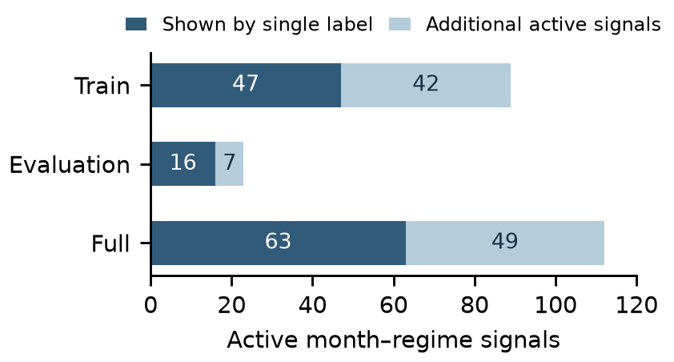
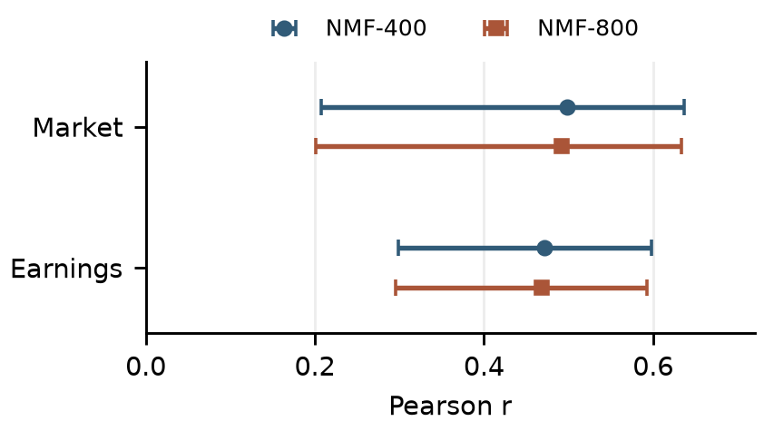

# 한국 경제 뉴스의 다중 이슈 국면 탐지와 시장·검색 지표의 동행성 분석
### Detecting Multiple Issue Regimes in Korean Economic News and Their Associations with Market Returns and Search Interest

## 요 약

월별 경제 뉴스를 하나의 대표 이슈로 요약하면 같은 시기에 부각된 다른 이슈를 파악하기 어렵다. 본 연구는 2021년 1월부터 2026년 7월까지 국내 경제 일간지 3곳의 기사 931,709건을 이용해 여러 경제 이슈를 한 달에 함께 표시하는 방법을 제안하고, 단일 대표 국면과 비교하였다. 학습 기간 48개월에 구축한 TF-IDF와 비음수 행렬 분해(NMF)를 고정하여 평가 기간 19개월의 뉴스 국면을 산출하였다. 14개 토픽을 6개 경제 국면으로 집계하고 학습 기간 기준 표준화 점수가 0.5 이상인 국면을 활성으로 정의하였다. 전체 67개월에서 112개 활성 신호 중 49개(43.75%)가 단일 대표 국면에 별도 표시되지 않았다. KOSPI의 변동성 정규화 월간 수익률과 금리·물가 및 자본거래 국면 사이에 음의 동시점 연관성이 관찰되었다. 평가 구간 82주의 네이버 상대 검색 지수에서는 기업실적 뉴스와 기업실적 검색 간 양의 동행성이 반복 상한 변경에도 유지되었다. 분석 결과는 뉴스 요약 과정의 표현 차이를 보여 주며, 국면의 의미와 활용도를 평가하려면 독립적인 기사 라벨과 비교 기준이 필요하다.

민감도 분석에서 반복 상한을 800회로 높인 모형은 447회에 수렴하였다. 이 모형의 가계대출 비중을 부동산 국면에 합쳐 동일한 6개 국면으로 비교했을 때도 미표시 비율은 43.24%였다. 반면 시황 뉴스와 국내증시 검색의 동행성은 상관계수의 방향이 유지되었으나 검정 설정에 따라 5% 유의성 판정이 달라졌다.

**핵심어** 경제 뉴스, 비음수 행렬 분해, 다중 국면, 표본 외 평가, 검색 관심도

## ABSTRACT

Monthly summaries of economic news often assign a single dominant issue to each period, obscuring other issues that receive simultaneous attention. We use 931,709 articles from three Korean economic newspapers between January 2021 and July 2026 to detect and compare multiple active issue regimes. Vocabulary, TF-IDF weights, and a 14-topic non-negative matrix factorization basis were estimated using the first 48 months and held fixed during the 19-month evaluation period. Topics were aggregated into six economic regimes. A regime was active when its monthly share had a training-standardized score of at least 0.5. Across 67 months, 49 of 112 active regime signals (43.75%) were omitted as separate labels under a single-dominant summary. In a full-sample contemporaneous regression, the rates-and-inflation and capital-transaction regimes were negatively associated with volatility-scaled KOSPI returns. Weekly changes in earnings news and related search interest moved together in 82 evaluation weeks, and this association persisted under a higher NMF iteration cap. These results quantify differences in news representation. Independent article labels and external benchmarks are needed to establish semantic validity and practical utility.

With a higher iteration cap and household debt combined with real estate, the six-regime specification omitted 43.24% of active signals. The market-news association remained positive across NMF specifications, but its significance was sensitive to covariance settings.

**Keywords** Economic news, Non-negative matrix factorization, Multiple regimes, Out-of-sample evaluation, Search interest

<!-- page -->

## Ⅰ. 서론

경제 뉴스에서 금리, 부동산, 기업실적과 증시 이슈는 같은 달에 동시에 부각될 수 있다. 금리 인상기에는 통화정책 발표와 주택금융 관련 보도가 함께 증가하고, 실적 발표기에는 개별 기업의 공시와 시장 전반의 수급 보도가 같은 시기에 집중된다. 월별 뉴스 동향을 하나의 대표 이슈로만 표시하면 가장 두드러진 이슈를 쉽게 파악할 수 있으나, 두 번째와 세 번째 이슈가 어느 정도 부각되었는지는 알기 어렵다.

경제 텍스트를 활용한 연구는 언론 보도에서 정책 불확실성이나 경기 관련 정보를 추출해 경제 동향을 분석해 왔다[1–3]. 국내에서도 한국어 뉴스에서 경제심리를 계량화하거나 거시경제 분석에 텍스트마이닝을 적용한 사례가 있다[4, 5]. 본 연구는 월별 경제 뉴스에서 여러 이슈가 함께 활성화된다는 점에 주목한다. 여기서 국면은 경제 전체의 확장·수축 단계를 가리키는 상태 변수가 아니라, 특정 이슈의 보도 비중이 학습 기간의 통상 수준을 넘어선 시기를 뜻한다. 월별로 함께 표시할 수 있는 이슈의 수에는 별도의 상한을 두지 않는다.

이 연구의 질문은 세 가지다. 첫째, 같은 뉴스 자료를 한 달에 하나의 대표 국면으로 정리하면 활성 신호가 얼마나 별도 표시에서 빠지는가? 둘째, 뉴스 국면의 월별 변동은 KOSPI 수익률과 어떤 동시점 연관성을 갖는가? 셋째, 같은 이슈를 다룬 뉴스와 검색 관심도의 주별 변화는 뉴스 특징 추출 모형의 적합에 사용하지 않은 기간에도 함께 움직이는가?

단일·다중 방식의 비교에서는 기사 집합과 국면 점수를 고정한다. 따라서 두 요약에서 드러나는 차이를 모형 적합이나 기사 선정 차이가 아닌 표시 규칙의 차이로 해석할 수 있다. 서로 다른 기간을 비교할 때도 국면별 기준을 새로 추정하지 않고 같은 학습 기준을 적용한다.

이를 위해 빅카인즈 기사 키워드에 비음수 행렬 분해를 적용하고, 학습 기간에 구축한 특징 추출 체계를 평가 기간에 고정하였다. 동일한 국면 점수에서 단일·다중 표시를 만들어 비교하고, 시장·검색 지표는 서로 다른 시간 단위로 분석하였다. 논문의 구성은 다음과 같다. Ⅱ절에서 관련 연구를 검토하고, Ⅲ절에서 데이터와 국면 산출 방식을 설명한다. Ⅳ절에서는 월별 표시 차이와 시장·검색 결과를 제시하며, Ⅴ절에서 적용 범위와 후속 검증 과제를 논의한다.

## Ⅱ. 관련 연구

신문 보도 빈도를 이용한 경제정책 불확실성 지수[1], 경제 뉴스에서 추출한 경기 관련 텍스트 요인[2, 3], 한국은행의 뉴스심리지수[4]는 기사 자료를 경제 지표로 변환하는 대표적인 접근이다. 이러한 지표는 뉴스에 나타난 정보를 시간 순서대로 비교할 수 있게 한다. 본 연구는 뉴스의 종합 수준과 함께 이슈의 구성을 관찰한다. 종합 지수가 비슷한 두 달에도 금리, 부동산, 기업실적 등 뉴스 비중의 구성은 달라질 수 있기 때문이다.

비음수 행렬 분해는 문서와 단어가 이루는 비음수 행렬을 문서별 토픽 가중치와 토픽별 단어 가중치로 나눈다[6]. 한 문서에서 여러 토픽에 가중치를 부여하므로 이슈가 겹쳐 나타나는 기사와 월별 보도 구성을 표현할 수 있다. 토픽의 상위 단어가 해석에 도움을 주더라도, 통계적 응집도와 토픽의 의미적 타당성은 별개의 문제다[7]. 이에 따라 본 연구는 토픽을 경제 국면에 매핑하는 규칙과 기준을 제시하고, 반복 횟수 변화에 따른 결과의 민감도를 확인한다.

검색 지수는 가계나 투자자의 정보 탐색을 관찰하는 데 이용되어 왔다[8]. 다만 언론 보도와 검색이 함께 늘어나는 시기에는 같은 경제 사건이 두 자료에 동시에 반영될 수 있다. 여기서는 이슈별 뉴스와 검색의 주간 변화를 비교하고, 시장과의 분석에서는 동시점 회귀에 시계열 자기상관과 이분산성을 고려한 공분산 추정을 적용한다[9, 10].

토픽 모델의 비교에서도 두 평가 단위를 구분할 필요가 있다. LDA는 문서를 토픽의 확률 혼합으로 표현한다[11]. 여러 토픽 모델을 실제 자료에 적용한 연구는 응집도와 토픽 해석을 함께 검토할 필요가 있음을 보여 준다[12]. 본 연구는 같은 어휘와 표본에서 두 모형을 비교하고, 토픽 수준의 유사도와 경제 도메인 수준의 재현 여부를 각각 확인하였다. 예를 들어 서로 다른 토픽이 같은 부동산 국면에 매핑될 수 있으므로, 국면이 반복해서 나타난다는 사실만으로 토픽의 단어 구성이 동일하다고 볼 수 없다.

시장 분석에서는 수익률에 반영된 경제 정보와 보도 자체의 반응이 같은 월에 섞인다. 검색 분석에서도 언론과 독자가 같은 사건에 반응할 수 있다. 두 지표는 뉴스 국면이 실제 경제·정보 탐색 활동과 어느 정도 함께 움직이는지를 비교하는 자료로 활용하였다.

<!-- page -->

## Ⅲ. 연구 방법

### 3.1 분석 자료

빅카인즈에서 매일경제·서울경제·한국경제의 경제 섹션 기사를 수집하였다. 분석 기간은 2021년 1월부터 2026년 7월까지 67개월이며, 기사 전문에서 추출된 명사 키워드 필드를 이용하였다. 기사 ID, 월, 키워드 결측과 중복을 점검한 뒤 931,709건을 코퍼스로 확정하였다. 학습 어휘에 매칭되는 토큰이 없는 11건은 국면 비중의 집계에서 제외하였다.

시장은 한국은행 경제통계시스템(ECOS) 등을 바탕으로 구성한 월별 패널을 사용하였다. KOSPI 월간 로그수익률을 직전 12개월 월간 수익률의 표본 표준편차로 나누어, 과거 변동성 대비 당월 수익률의 크기를 측정하였다. 검색 자료는 네이버 데이터랩에서 얻은 상대지수다. 검색어 그룹을 공통 앵커인 ‘은행’과 함께 조회한 후 각 그룹의 지수를 같은 날의 앵커 지수로 나누고, ISO 주차별로 평균하였다.

**Table 1. Sample periods and numbers of articles**

| 구간 | 월 범위 | 월수 | 기사 수 |
| --- | --- | ---: | ---: |
| 학습 | 2021.01–2024.12 | 48 | 643,095 |
| 평가 | 2025.01–2026.07 | 19 | 288,614 |
| 전체 | 2021.01–2026.07 | 67 | 931,709 |

### 3.2 학습 기간 고정 특징 추출

학습 기간 기사에서 문서빈도 200 이상, 전체 학습 문서의 15% 이하인 단어를 남겼다. 최대 30,000개 어휘의 상한을 적용한 최종 사전에는 22,193개가 포함되었다. 매월 3,000건씩 비복원 추출한 144,000건에 TF-IDF 변환과 NMF를 적합하였다. NMF의 토픽 수는 14개로 고정하였다. 초기화는 NNDSVD, 최적화는 좌표하강법, 난수 시드는 42를 사용하였다. 기준 모델은 반복 상한을 400회로 두었다.

학습한 사전과 IDF를 이용해 기사를 벡터로 변환하고, 고정된 NMF 기저에 투영하여 문서별 토픽 가중치를 구하였다. 각 문서의 토픽 가중치를 합계 1로 정규화한 뒤 해당 국면에 할당된 토픽의 비중을 합산하였다. 월별 또는 주별로 문서 비중을 평균해 국면별 뉴스 시계열을 만들었다. 평가 기간의 기사는 어휘 선정, IDF 추정, NMF 기저 적합에 사용하지 않았다.

월별 비중은 해당 월의 유효 기사에 동일한 가중치를 부여한 평균이다. 특정 언론사의 기사 수가 늘면 그 언론사의 어휘와 이슈 구성이 월평균에 더 많이 반영될 수 있다. 주별 집계에도 같은 변환기를 적용하여 월별 국면 분석과 주별 검색 비교에서 특징 정의를 일관되게 유지하였다.

### 3.3 토픽 매핑과 활성화

경제 도메인 사전과 토픽별 단어 가중치를 사용하여 토픽을 국면으로 매핑하였다. 가장 높은 도메인 점유율이 1% 미만이면 잔차, 차순위 도메인의 가중치 합이 최상위의 90% 이상이면 경합으로 처리하였다. 기준 모델에서는 8개 토픽이 금리·물가, 부동산, 첨단산업, 시황, 기업실적, 자본거래의 6개 국면으로 배정되었다. 기준 모델의 학습 기간 평균 비중에서 잔차·경합 토픽은 54.30%를 차지했다. 따라서 여섯 국면은 전체 보도의 부분 집합을 요약한다. 첨단산업의 핵심 단어는 전기차와 배터리에 집중되어 있었으며, 가계대출과 대외통상은 독립 국면으로 형성되지 않았다.

국면 d의 t월 비중을 s(d,t), 학습 기간 평균과 표준편차를 각각 μ(d), σ(d)라고 하면 월별 활성화 점수는 식 (1)과 같다.

> z(d,t) = [s(d,t) − μ(d)] / σ(d)    (1)

다중 표시에서는 점수가 0.5 이상인 국면을 모두 활성으로 둔다. 단일 방식은 점수가 가장 높은 국면 하나를 선택한다. 두 방식에 동일한 활성 기준을 적용하면, 어느 국면도 기준을 통과하지 않은 달은 비활성이다. 누락 신호 수는 활성 국면 수가 두 개 이상인 달마다 대표 국면 외에 남는 신호 수를 합산해 구한다.

학습 기간 기준으로 활성화가 시작되는 기사 비중은 시황 6.35%, 기업실적 6.19%, 부동산 12.89%였다. 각 비중에 서로 다른 기준이 적용되므로 평균 비중이 큰 분야가 대표 국면으로 항상 선택되는 구조는 아니다.

### 3.4 대안 모형 비교와 안정성

같은 14개 토픽과 48,000건의 내부 검증 자료에서 NMF의 응집도 Cᵥ는 0.8261, NPMI는 0.3020이었다. LDA의 값은 각각 0.7466과 0.2246이었다. 어휘와 문서는 같지만 NMF는 TF-IDF, LDA는 단어 빈도를 입력으로 사용하므로, 이 차이는 입력 표현을 포함한 모형 설정의 비교다.

학습 표본의 80%를 사용한 재표본화 10회와 초기화·시드 변경 11회에서 여섯 기준 국면이 모두 형성되었다. 다만 재표본화에서 14개 토픽의 평균 코사인 유사도는 0.8492였고, 전기차·배터리 토픽은 평균 0.7263에 그쳤다. 국면이 반복해서 형성되더라도 개별 토픽의 구성은 표본에 따라 바뀔 수 있다.

<!-- page -->

## Ⅳ. 실증 분석 결과

### 4.1 단일 대표 국면과 다중 국면의 비교

표 2는 같은 국면 점수를 사용해 두 표시 방법을 비교한 결과다. 전체 67개월 중 39개월(58.21%)에 두 개 이상의 국면이 동시에 활성화되었다. 기준을 넘은 국면이 한 개도 없는 달은 4개월이었으며, 활성이 한 개뿐인 달은 24개월이었다. 따라서 다중 방식의 활성 신호 112개 중 단일 방식으로 별도 표시할 수 있는 신호는 63개다. 나머지 49개(43.75%)는 다른 이슈가 대표 국면으로 선택된 달에 관측된 활성 신호다.

**Table 2. Active and omitted signals by sample period**

| 구간 | 월수 | 2개 이상 활성 월 | 활성 신호 | 미표시 신호 |
| --- | ---: | ---: | ---: | ---: |
| 학습 | 48 | 32 | 89 | 42 (47.19%) |
| 평가 | 19 | 7 | 23 | 7 (30.43%) |
| 전체 | 67 | 39 | 112 | 49 (43.75%) |

학습 구간에 비해 평가 구간에서 동시 활성 월의 비중은 낮았다(66.67%와 36.84%). 평가 구간에도 단일 방식에서 별도로 표시되지 않는 신호가 7개 있었다. 이 수치는 월과 국면의 조합을 집계한 것으로, 전체 기사 중 몇 퍼센트가 요약에서 빠졌는지를 나타내는 비율과 구분된다. 기준을 넘는 두 번째 이슈를 별도 항목으로 보여 주는 요약을 설계할 때, 어느 정도의 월별 차이가 발생하는지를 보여 준다.

2022년 10월에는 금리·물가가 대표 국면으로 선정되었고 부동산도 활성 기준을 넘었다. 단일 표시에서는 금리·물가만 드러나지만, 기사 자료에는 한국은행 기준금리 인상 보도와 주택 거래 위축 및 전세가격 하락 관련 보도가 함께 나타났다. 이 사례는 하나의 대표 레이블 아래에 묶이는 다른 이슈를 찾을 수 있음을 보여 준다. 사례는 다중 활성 점수를 기준으로 선정했으므로, 모든 월에서 부차 국면이 같은 해석 가치를 갖는지는 별도 평가가 필요하다.

2026년 2월 평가 구간에서는 시황이 대표 국면이었고 기업실적도 기준을 넘었다. 증시 동향을 대표 이슈로 두면서 기업 실적 발표를 같은 달의 별도 이슈로 확인할 수 있는 사례다. 표 3은 저장된 월별 사례 자료에서 대표 국면과 추가로 표시된 국면을 정리한다.

**Table 3. Examples of additional active issues**

| 월 | 대표 국면 | 추가 활성 국면 |
| --- | --- | --- |
| 2021.09 | 첨단산업 | 부동산·자본거래 |
| 2022.10 | 금리·물가 | 부동산 |
| 2026.01 | 시황 | 첨단산업 |
| 2026.02 | 시황 | 기업실적 |

### 4.2 NMF 수렴 조건에 대한 민감도

기준 모델은 400회 반복 상한에 도달하였다. 같은 학습 표본과 초기화 설정으로 상한을 800회로 높였을 때 허용오차 10⁻⁴에서 447회 만에 종료되었다. 재구성 오차는 369.8048에서 369.7777로 감소하였다. 토픽을 일대일로 정렬한 후 계산한 평균 코사인 유사도는 14개 전체 0.9802, 최저 0.7846이었다. 가장 크게 변한 토픽을 제외한 13개 평균은 0.9953이었다.

수렴 모델에서 부동산에 배정되었던 한 토픽이 가계대출로 분리되었다. 가계대출 비중을 부동산에 합친 비교에서는 111개 활성 신호 중 48개(43.24%)가 단일 방식에서 별도 표시되지 않았다. 가계대출을 별도 국면으로 둔 7국면에서는 125개 중 63개(50.40%)였다. 후보 국면 수가 늘면 같은 달에 함께 표시할 수 있는 항목도 늘어나므로, 수렴 조건에 따른 표현 차이는 같은 수의 국면을 사용한 결과를 중심으로 비교하였다.

<!-- page -->

### 4.3 KOSPI 수익률과의 동시점 연관성

월별 KOSPI의 변동성 정규화 로그수익률을 종속변수로, 6개 국면의 표준화 점수를 설명변수로 하여 전체 67개월에서 동시점 회귀를 추정하였다. 표준오차는 Newey–West HAC 공분산으로 계산하고 최대 시차를 3개월로 설정하였다. 6개 회귀계수의 유의확률에 Holm 보정을 적용하였다.

**Table 4. Contemporaneous KOSPI regression**

| 국면 | 추정계수 β | Holm 보정 p |
| --- | ---: | ---: |
| 금리·물가 | −0.7418 | 0.0024 |
| 부동산 | −0.2082 | 0.3155 |
| 첨단산업 | −0.2583 | 0.3289 |
| 시황 | −0.1437 | 0.3289 |
| 기업실적 | −0.1443 | 0.5008 |
| 자본거래 | −0.5299 | 0.0129 |

금리·물가 및 자본거래 국면이 변동성 정규화 수익률과 음의 관계를 보였다. 회귀의 결정계수는 0.1619, 조정 결정계수는 0.0781이었다(HAC F=4.6833, p=0.000573). NMF-800의 7국면 사양에서도 두 계수의 부호와 5% 보정 유의성은 유지되었다. 7국면 사양의 결정계수는 0.1698, 조정 결정계수는 0.0713이었다. 같은 시점의 뉴스와 시장 움직임에는 공통 사건의 영향이나 시장 변동에 대한 보도의 반응이 함께 들어갈 수 있다. 따라서 이 회귀의 추정값은 같은 달 변수 간 관계를 기술하는 데 사용한다.

수익률을 과거 변동성으로 나누었으므로, 회귀계수는 월간 수익률의 퍼센트포인트 변화로 곧바로 읽을 수 없다. 예를 들어 다른 국면 점수가 같은 조건에서 금리·물가 점수가 1만큼 높을 때, 변동성으로 조정한 수익률의 추정값이 0.7418 낮다는 의미다. 조정 결정계수는 설명변수 수를 반영하므로, 7국면 결과에서 일반 결정계수의 증가만을 근거로 모형 적합도가 개선됐다고 해석하기 어렵다.

<!-- column -->

하락 조기경보는 동시점 분석과 별도로 평가하였다. 평가 구간에서 금리·물가 점수가 0.5 이상일 때 경고를 발령하고, 이후 1~2개월 안에 월 수익률이 한 번이라도 음수이면 하락 사건으로 정의하였다. 이후 두 달을 관측할 수 있는 17개월 중 경고 1건은 오경보였고, 하락 9건은 경고되지 않았다(TP 0, FP 1, FN 9, TN 7). 이 평가로 조기경보 성과를 확인하지 못했다.

가계대출 비중이 분리된 NMF-800에서는 이전 달 가계대출 뉴스 비중을 추가한 수익률 예측을 보조적으로 비교하였다. 평가 19개월의 확장창 RMSE는 자기회귀 기준선 15.2825에서 뉴스 포함 모형 13.8687로 낮아졌다. 고정창에서는 15.6018에서 15.3919로 차이가 작았다. 이 결과는 연속 수익률 오차에 대한 비교이므로 앞의 하락 경보 적중률과는 평가 대상이 다르며, 평가 구간과 모형 설정을 확대해 확인할 필요가 있다.

### 4.4 검색 관심도의 동시점 변화

뉴스 국면 비중과 검색 지수를 ISO 주차로 맞춘 뒤 전체·학습·평가 구간 각각에서 1차 차분하였다. 원자료는 학습 209주와 평가 83주였으며, 구간별 첫 주를 차분 기준으로 사용한 뒤 학습 208주와 평가 82주가 남았다. 8개 뉴스–검색 쌍에서 동시점과 앞뒤 한 주의 관계를 비교하고, 각 구간의 24개 검정에 Holm 보정을 적용하였다. 평가 구간에서 동시점 기준으로 시황과 기업실적 쌍이 5% 기준을 충족하였다.

**Table 5. Contemporaneous weekly search associations in 82 evaluation weeks**

| 뉴스–검색 쌍 | NMF-400 r | 보정 p | NMF-800 r | 보정 p |
| --- | ---: | ---: | ---: | ---: |
| 시황–국내증시 | 0.4984 | 0.0432 | 0.4920 | 0.0508 |
| 기업실적–기업실적 | 0.4718 | 0.0011 | 0.4687 | 0.0014 |

<!-- page -->

### 4.5 검색 결과의 민감도

표 5의 유의확률은 HAC 최대 시차 4주를 적용한 결과다. 기업실적 뉴스와 관련 검색의 양의 동행성은 반복 상한을 높인 NMF-800에서도 유지되었다. 시황은 상관계수 변화가 작았으나, NMF-800의 보정 유의확률이 0.0508로 5% 기준을 넘었다. 기준 모델에서도 HAC 최대 시차를 8주로 늘리면 시황의 보정 유의확률이 0.0616이었다. 기업실적과 시황의 동시점 상관계수는 기준 모델에서 블록 길이 2·4·8주를 사용한 이동 블록 부트스트랩의 95% 구간에서 모두 양의 범위에 있었다.

평가 구간 첫 주의 차분에 직전 학습 주를 참조하는 83주 방식도 비교하였다. 82주 방식과 비교한 8개 동시점 상관계수의 최대 절대 차이는 0.0127이었다. 두 방식에 각각 24개 검정 Holm 보정을 적용한 후 8개 동시점 쌍의 5% 유의성 판정은 같았다. 네이버 원자료는 조회 기간 최댓값을 기준으로 산출된 상대지수이므로, 뉴스 특징 추출에 적용한 학습 기간 고정의 해석을 검색 자료의 API 정규화 전체에 확대하지 않는다.

공통 앵커로 나누는 과정에서 분모의 움직임이 관계에 영향을 줄 수 있다. 앵커로 나누지 않은 원래 상대지수의 차분에서도 시황은 r=0.5355(보정 p=0.0327), 기업실적은 r=0.5508(보정 p=0.00016)이었다. 앵커 차분을 통제변수로 포함하면 기업실적은 5% 기준을 충족했으며(보정 p=0.0047), 시황은 기준을 넘었다(p=0.0713). 검색 지수의 구성 방식을 바꾸어도 기업실적 결과가 비교적 안정적으로 나타났다는 근거다.

<!-- column -->

그림 2는 평가 구간 82주에서 블록 길이 4주로 계산한 상관계수의 95% 구간이다. 그림의 구간은 부트스트랩 불확실성을 나타내며, 표 5의 유의확률은 HAC 표준오차와 24개 검정 Holm 보정에 근거한다.

### 4.6 결과의 해석

월별 활성 점수는 이슈에 할당된 기사 비중이 학습 기간의 분포와 비교해 얼마나 높아졌는지를 보여 준다. 월별 수익률과의 연관성은 이러한 이슈 비중의 변화와 금융시장 움직임을 같은 시점에서 비교한 결과다. 주별 검색 결과는 기사 보도 비중과 검색 관심도가 함께 변하는 이슈를 보여 주며, 검색량의 절대 규모나 전체 인구의 심리 수준을 직접 측정하지 않는다.

예를 들어 금리·물가 뉴스와 금리 검색의 동시점 상관은 평가 구간에서 0.3397이었지만, 24개 검정에 보정한 유의확률은 0.3575였다. 학습 구간에서 확인한 관계를 이후 구간에 그대로 적용하기 어려운 사례다. 검색 결과는 상관계수 크기, 보정 후 판정, 모형 변경에 대한 민감도를 함께 해석하였다.

동일한 토픽에서 산출한 점수라도 월별 표시와 주별 검색 분석의 역할은 다르다. 다중 표시는 한 달에 여러 이슈를 병렬로 읽도록 돕는다. 검색 분석은 뉴스 이슈의 변화가 외부의 정보 탐색 지표에도 나타나는지를 살핀다. 시황처럼 추정 조건에 민감한 쌍은 상관의 방향과 검정 결과를 함께 제시하는 것이 적절하다. 기업실적 쌍은 두 NMF 설정에서 양의 동행성을 보였으나, 보도와 검색이 같은 실적 발표에 반응했을 가능성은 남는다.

<!-- page -->

### 4.7 적용상의 한계

토픽과 국면의 매핑에는 경제 사전과 가중치 기준이 사용되었다. 이 기준에서 명확히 배정되지 않은 토픽은 잔차 또는 경합으로 유지하였다. 독립 평가자가 기사에 다중 라벨을 부여하는 절차는 수행하지 않았다. 따라서 이 결과에서 집계된 활성 국면과 독자가 판단한 주요 경제 이슈가 어느 정도 일치하는지는 추가 확인이 필요하다.

국면 활성화 임계값은 학습 구간의 표준편차를 단위로 한다. 이 규칙은 국면별 평균 비중 차이를 보정하지만, 낮은 임계값은 부수 이슈도 활성으로 만들 수 있다. 특히 후보를 6개에서 7개로 늘릴 때의 추가 표시는 분류 체계 변경의 영향을 함께 받는다. 실제 활용도를 평가하려면 월별 주요 사건의 독립 목록을 만들고, 단일·다중 방식의 주요 이슈 회수율과 과잉 표시율을 같은 평가 월에서 비교할 필요가 있다.

## Ⅴ. 결론

이 연구는 국내 경제 일간지 3곳의 기사 931,709건을 이용해 뉴스 이슈를 월별로 정리하는 두 방법을 비교하였다. 학습 기간에서 14개 토픽을 적합하고 규칙에 따라 6개 국면을 구성하였다. 학습 기간의 분포로 국면 비중을 표준화한 결과, 전체 67개월 중 39개월에서 두 개 이상의 이슈가 활성화되었다. 단일 대표 국면을 선택했을 때 112개 활성 신호 중 49개가 별도 표시에서 빠졌다. 평가 구간으로 한정해도 23개 중 7개가 별도 표시되지 않았다.

이 결과는 단일 레이블의 정보 표현 범위를 수치로 보여 준다. 월간 동향을 빠르게 훑는 요약에는 대표 국면 하나가 유용할 수 있으며, 같은 달에 함께 부각된 경제 문제를 검토할 때는 활성 국면을 함께 보여 주는 표시를 사용할 수 있다. 연구에서 사용한 다중 활성화 규칙은 두 방법의 차이를 같은 입력과 같은 점수로 비교할 수 있게 한다. 수렴 조건을 변경한 뒤 동일한 6국면 구조로 맞춘 비교에서도 별도 미표시 비율은 유사했다.

<!-- column -->

시장과 검색 자료에서 관찰한 관계는 서로 다른 시간 단위의 동시점 결과다. KOSPI 회귀에서는 금리·물가와 자본거래에 음의 연관성이 나타났다. 평가 기간의 기업실적 뉴스와 검색은 주별 변화를 기준으로 양의 관계를 보였으며 NMF 반복 상한 변화에도 유지되었다. 시황의 유의성은 일부 추정 조건에 민감하였다. 하락 조기경보는 평가 가능한 17개월에서 적중 사례가 확인되지 않았다.

본 연구가 사용한 기사의 범위는 국내 경제 일간지 3곳으로 한정된다. 뉴스 특징 추출에 대해 학습 기간을 고정했으며, 결과 해석에는 검색 API의 상대지수, 시장 분석의 소표본, 기사 의미 평가의 부재가 영향을 준다. 후속 연구에서는 독립 평가자가 모형 결과를 가린 채 기사에 복수의 이슈를 표시하고, 평가자 간 일치도를 확인할 필요가 있다. 같은 기간의 월별 사건 목록과 함께 단일 및 다중 표시를 평가하면, 추가로 표시된 이슈가 실제로 의미 있는 정보를 제공하는지 검증할 수 있다.

### 후속 검증

기사 평가에서는 각 평가자가 하나 이상의 이슈를 선택할 수 있도록 하고, 여러 국면의 가중치가 높은 기사와 배정이 모호한 기사를 모두 포함해야 한다. 평가자 간 일치도를 먼저 제시한 뒤, 모델이 추가로 표시한 이슈 중 독립 평가에서도 확인된 비율을 계산하면 단일·다중 표시를 같은 기준에서 비교할 수 있다. 또한 연속된 평가 월에 대해 임계값을 바꾸어, 추가 표시 증가가 주요 사건 회수로 이어지는지 확인할 수 있다.

<!-- page -->

## REFERENCES
[1] S. R. Baker, N. Bloom, and S. J. Davis, “Measuring Economic Policy Uncertainty,” *The Quarterly Journal of Economics*, vol. 131, no. 4, pp. 1593-1636, Nov. 2016. DOI: 10.1093/qje/qjw024.
[2] L. Bybee, B. Kelly, A. Manela, and D. Xiu, “Business News and Business Cycles,” *The Journal of Finance*, vol. 79, no. 5, pp. 3105-3147, Oct. 2024. DOI: 10.1111/jofi.13377.
[3] L. A. Thorsrud, “Words are the New Numbers: A Newsy Coincident Index of the Business Cycle,” *Journal of Business & Economic Statistics*, vol. 38, no. 2, pp. 393-409, Apr. 2020. DOI: 10.1080/07350015.2018.1506344.
[4] B. Seo, Y. Lee, and H. Cho, “Machine-Learning-Based News Sentiment Index (NSI) of Korea,” *BOK Working Paper*, no. 2022-15 (and *National Accounts Review*, no. 2022-1), Bank of Korea, 2022. DOI: 10.2139/ssrn.4230611.
[5] S. Kim, Y. J. Lee, J. Shin, and K. Y. Park, “Text Mining for Economic Analysis,” *Journal of Korean Economic Analysis*, vol. 26, no. 1, pp. 1-70, 2020. DOI: 10.22823/jkea.26.1.202004.1.
<!-- column -->

[6] D. D. Lee and H. S. Seung, “Learning the parts of objects by non-negative matrix factorization,” *Nature*, vol. 401, no. 6755, pp. 788-791, Oct. 1999. DOI: 10.1038/44565.
[7] D. O'Callaghan, D. Greene, J. Carthy, and P. Cunningham, “An analysis of the coherence of descriptors in topic modeling,” *Expert Systems with Applications*, vol. 42, no. 13, pp. 5645-5657, Aug. 2015. DOI: 10.1016/j.eswa.2015.02.055.
[8] Z. Da, J. Engelberg, and P. Gao, “The Sum of All FEARS: Investor Sentiment and Asset Prices,” *The Review of Financial Studies*, vol. 28, no. 1, pp. 1-32, Jan. 2015. DOI: 10.1093/rfs/hhu072.
[9] J. H. Stock and M. W. Watson, *Introduction to Econometrics*, 4th ed. New York, NY: Pearson, 2019.
[10] W. K. Newey and K. D. West, “A Simple, Positive Semi-Definite, Heteroskedasticity and Autocorrelation Consistent Covariance Matrix,” *Econometrica*, vol. 55, no. 3, pp. 703-708, May 1987. DOI: 10.2307/1913610.
[11] D. M. Blei, A. Y. Ng, and M. I. Jordan, “Latent Dirichlet Allocation,” *Journal of Machine Learning Research*, vol. 3, pp. 993-1022, Jan. 2003.
[12] R. Egger and J. Yu, “A Topic Modeling Comparison Between LDA, NMF, Top2Vec, and BERTopic to Demystify Twitter Posts,” *Frontiers in Sociology*, vol. 7, 886498, May 2022. DOI: 10.3389/fsoc.2022.886498.
